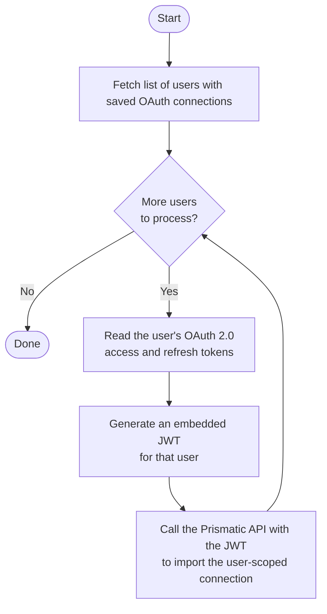

# Import customer connections

This example assumes that you have an existing OAuth 2.0 connection saved outside of Prismatic, and would like to import that connection as a reusable **user-scoped connection**.

## Authentication with Prismatic

Because we're importing user-scoped connections, we must import them as the authenticated user who owns the connection.
Therefore, we will generate [embedded JWTs](https://prismatic.io/docs/get-started/embedded-marketplace/authenticate-embedded-users/) for the authenticated user and use the JWT to authenticate our API requests.

## Setup

1. Copy the `.env.example` file to `.env`
   1. Set `PRISMATIC_ORGANIZATION_ID` to your organization's ID.
   2. Set `CONNECTION_STABLE_KEY` to your reusable user connection's stable key.
   3. Set `PRISMATIC_BASE_URL` to your Prismatic instance's base URL; update for your custom domain if necessary.
2. Ensure that your embedded private key is saved in the `private.key` file in the same directory.

## Importing connections for multiple users

This diagram illustrates how our script works. We'll loop over each user, fetching their OAuth connection information and, generating a JWT for each user, and importing their connection into Prismatic.

